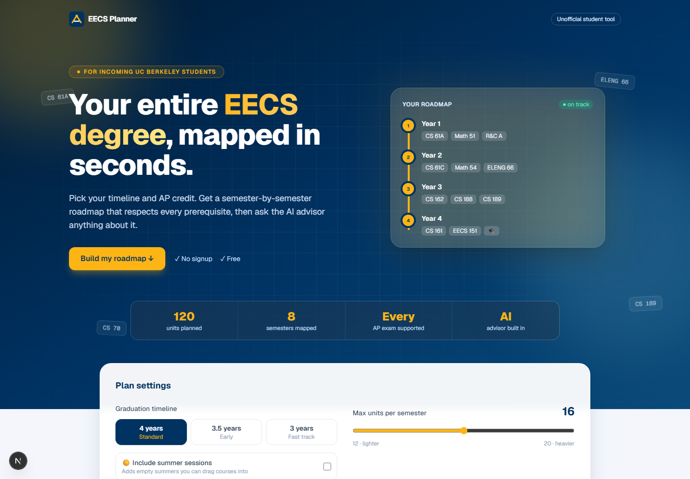
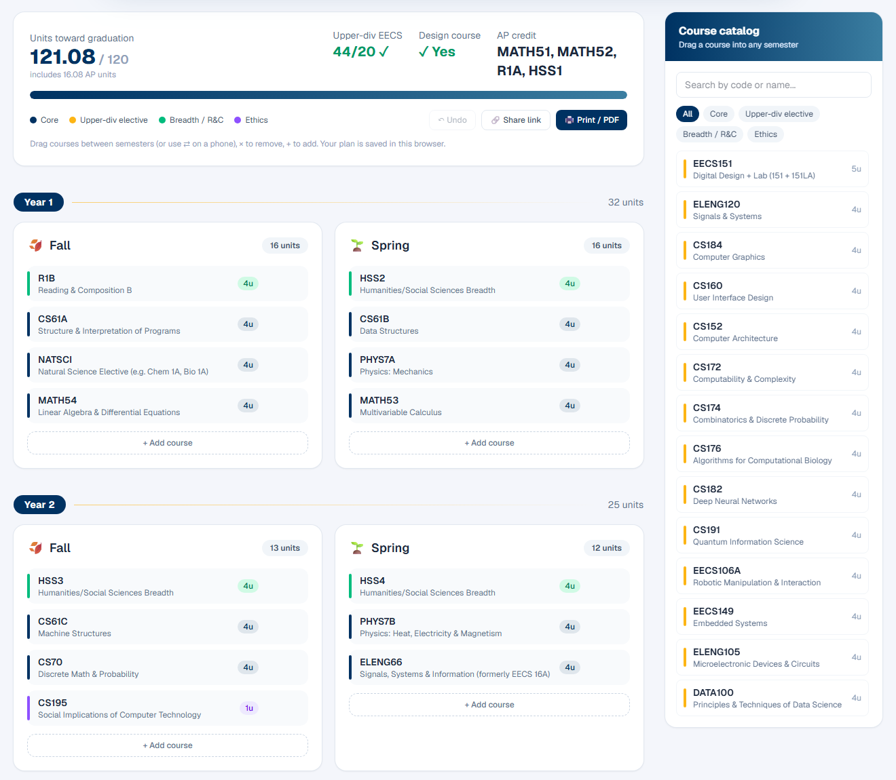
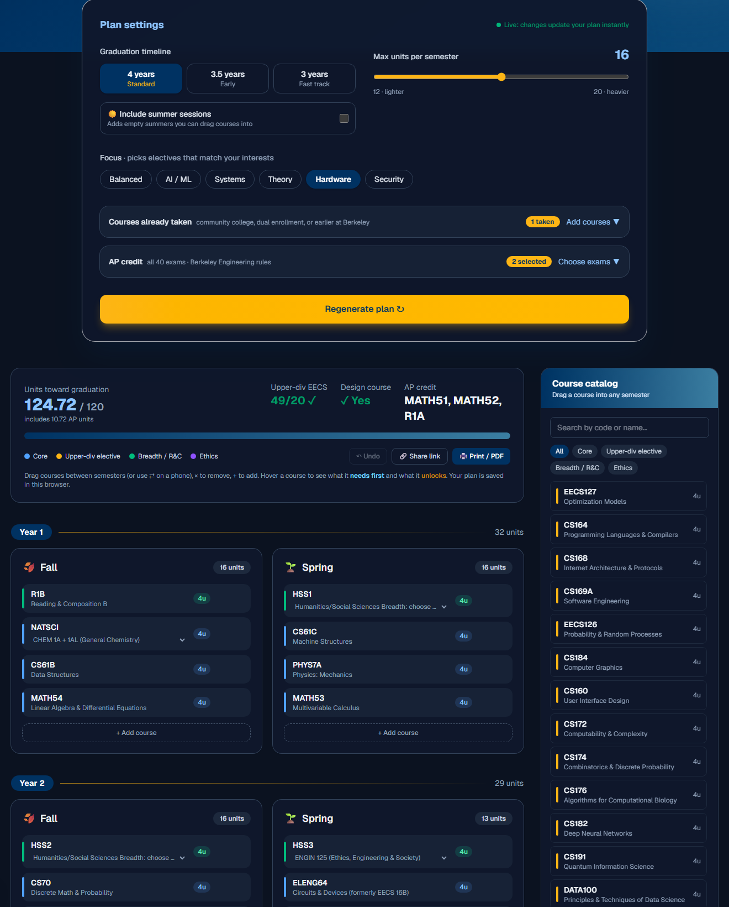

# UC Berkeley EECS Planner

Generates a semester-by-semester course roadmap for incoming UC Berkeley EECS students, then lets you reshape it by dragging courses around or by asking an AI advisor (Gemini) to change it for you.





<details>
<summary>Dark mode</summary>



</details>

## Features

- **Full degree plan:** every requirement for 2026–27 entering EECS students (lower-division math, physics, CS, ELENG 64/66, natural science, Reading & Composition, H/SS breadth, ethics, and upper-division electives) spread across 3, 3.5, or 4 years, with optional summer sessions.
- **AP credit by score:** all AP exams, following the College of Engineering chart, including unit caps and the 2-course H/SS limit.
- **Requirement checks:** prerequisites, term offerings, unit limits, the 12-unit full-time minimum, R&C deadlines, 20 upper-division EECS units, and the design course.
- **Focus tracks:** pick AI/ML, Systems, Theory, Hardware, or Security and the electives follow.
- **Courses already taken:** community college or dual-enrollment courses count as done.
- **Real choices:** pick the actual natural science course and H/SS category for each placeholder slot.
- **Requirement checks:** also 2 upper-division H/SS courses; real Fall/Spring/Summer offerings pulled from the EECS department's course pages.
- **Edit freely:** drag and drop (or "Move to…" on phones), add from the course catalog, remove, undo. Hover a course to see what it needs first and what it unlocks.
- **AI advisor:** answers questions as it writes (streamed), and proposes plan edits ("make Year 2 lighter") that you accept or reject.
- **Keep it:** plans are saved in your browser, can be shared as a link, and print cleanly to PDF.
- **Light and dark mode**, keyboard focus rings, and accessible contrast.

## Running locally

### Backend

```bash
pip install -r backend/requirements.txt
cp backend/.env.example backend/.env   # then add your Gemini API key
uvicorn backend.main:app --reload       # run from the repo root
```

The API runs at `http://127.0.0.1:8000`.

### Frontend

```bash
cd frontend
npm install
npm run dev
```

Open `http://localhost:3000`.

## Tests

```bash
pip install -r backend/requirements-dev.txt
python -m pytest                    # backend: planner rules, AP credit, validation, advisor

cd frontend
npx playwright test                 # browser: drag and drop, undo, saving, share links, advisor approval, dark mode, accessibility
```

The backend tests build a plan for every combination of timeline, unit limit, AP credit, and summer setting and check it against every rule. The browser tests drive the real page against the real backend; Gemini is faked in both, so no API key is needed. Locally, Playwright reuses running servers and your installed Chrome. GitHub Actions runs everything, plus the frontend typecheck, lint, and build, on every push.

## Updating course offerings

```bash
python scripts/update_offerings.py
```

Re-reads each course's Fall/Spring/Summer formats, actual scheduled terms, and official prerequisites from the EECS department's course pages into `backend/offerings.json`. Run it once a year, and check its printout: prerequisites written as prose need an entry in `MANUAL_PREREQS`.

## Measuring the AI advisor

```bash
python scripts/eval_advisor.py
```

Sends 10 typical requests ("make Year 2 lighter", "add CS 182 somewhere", …) to the real advisor and scores whether its suggested edits break any rule, before and after its automatic correction step. It uses your Gemini key (10–20 requests) and is paced for Gemini's free tier, which allows 5 requests per minute.

## Deploying (free)

Everything runs on free tiers: Vercel for the frontend, Render for the backend, and Gemini's free API tier.

**1. Backend on Render**
1. Sign in at [render.com](https://render.com) with GitHub, then **New → Blueprint** and pick this repo. It reads `render.yaml`.
2. When asked, enter your `GEMINI_API_KEY`. Leave `ALLOWED_ORIGINS` blank for now.
3. When it's live, copy its URL (e.g. `https://eecs-planner-api.onrender.com`).

**2. Frontend on Vercel**
1. Sign in at [vercel.com](https://vercel.com) with GitHub, **Add New → Project**, pick this repo, and set **Root Directory** to `frontend`.
2. Add environment variables:

| Variable | Value |
| --- | --- |
| `NEXT_PUBLIC_API_URL` | your Render URL from step 1 |
| `NEXT_PUBLIC_FEEDBACK_URL` | optional: a Google Form link, which adds a "Send feedback" button |
| `NEXT_PUBLIC_LINKS_URL` | optional: the URL of the companion EECS Links site, which adds "EECS Links" buttons (locally they point to `http://localhost:3001`) |

3. Deploy, and copy the site's URL (e.g. `https://eecs-planner.vercel.app`).

**3. Connect them:** in Render, set `ALLOWED_ORIGINS` to your Vercel URL and redeploy.

Things to know about the free tiers:
- **Render sleeps** after about 15 idle minutes; the next visitor waits up to a minute (the page says so).
- **Gemini's free tier allows 5 advisor requests per minute for everyone combined.** Past that, students see "the advisor has hit its usage limit, wait a minute". Each visitor is also limited to `ADVISOR_REQUESTS_PER_MINUTE` (default 10).

## Keeping course data fresh

A GitHub Action (`.github/workflows/refresh-course-data.yml`) re-reads the EECS course pages on the 1st of every month and, if anything changed, opens a pull request with the test results. To let it open pull requests, enable **Settings → Actions → General → Allow GitHub Actions to create and approve pull requests**. You can also run it any time from the Actions tab.

## API

| Method | Path             | Body                                         | Does                                           |
| ------ | ---------------- | -------------------------------------------- | ---------------------------------------------- |
| GET    | `/courses`       |                                              | Full course catalog                            |
| GET    | `/ap-exams`      |                                              | AP exams and the credit each score earns       |
| GET    | `/focus-tracks`  |                                              | Focus tracks, and when offerings were checked  |
| POST   | `/generate-plan` | `{ completed_courses: [], settings }`        | Builds a plan                                  |
| POST   | `/review-plan`   | `{ plan, settings }`                         | Re-checks an edited plan for problems          |
| POST   | `/advisor`       | `{ plan, question, settings, history }`      | Answers, and proposes plan edits when asked    |
| POST   | `/advisor/stream`| same as `/advisor`                           | Same, streamed as newline-delimited JSON       |

`settings` is `{ timeline, maxUnits, summer, focus, completed: [codes], ap: { examKey: score } }`. Malformed requests get a 422 explaining what's wrong.

## Curriculum

Course data lives in `backend/curriculum.py`, based on:

- [Berkeley Engineering: EECS major requirements (2026–27)](https://engineering.berkeley.edu/students/undergraduate-guide/degree-requirements/major-programs/electrical-engineering-computer-sciences/)
- [EECS department: lower-division requirements](https://eecs.berkeley.edu/resources/undergrads/eecs-2/degree-reqs-lowerdiv-2/)
- [Berkeley Engineering: AP/IB exam credit](https://engineering.berkeley.edu/students/undergraduate-guide/exams/)
- [Berkeley Engineering: H/SS requirement](https://engineering.berkeley.edu/students/undergraduate-guide/degree-requirements/humanities-and-social-sciences/)
- [EECS department course pages](https://www2.eecs.berkeley.edu/Courses/) for term offerings (`backend/offerings.json`)

Prerequisites for courses without an EECS course page (CS 191, EECS 106A, Data 100) are estimates and are marked as such in the course catalog. The H/SS page lists accepted categories rather than individual courses, so the H/SS slots offer categories; confirm specific courses with the Class Schedule. Units for ENGIN 125, ENGIN 185, PHILOS 121 and DATA C104 aren't on the EECS page and are assumed to be 3. This is an unofficial planning tool, so always confirm with an EECS advisor.
